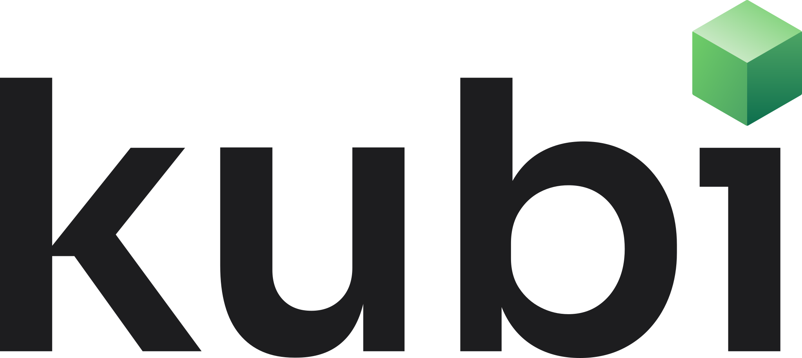

  <picture>
    <source media="(prefers-color-scheme: dark)" srcset="kubi-logo-reversed.svg">
    
  </picture>

<h3 align="center">Always-on Linux desktops for AI agents.</h3>

Give your AI agent its own Linux desktop that stays on. It sees the screen, clicks and types, runs commands and moves files through one API, a TypeScript SDK or a hosted MCP server. A person can watch live and take over at any time.

Kubi is in development and not available yet. 
Questions: <a href="mailto:support@trykubi.com">support@trykubi.com</a>

